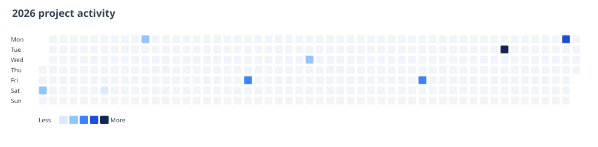

# daytile

`daytile` turns newline-delimited dated values into a deterministic, standalone SVG calendar heatmap. It is useful for build counts, exercise logs, support volume, research activity, or any other daily series that benefits from a compact year-at-a-glance view.

The implementation is a Rust library and CLI. It supports duplicate-date aggregation, Monday- or Sunday-first calendars, custom five-step palettes, accessible SVG metadata, leap years, JSON summaries, and safe output creation that will not overwrite an existing file unless asked.



## Install

```sh
cargo install --git https://github.com/nicholas-ruest/daytile
```

Or build from a clone with stable Rust 1.85 or newer:

```sh
cargo build --release
```

## Input

One JSON object per line is required. `label` is optional; duplicate dates are aggregated.

```json
{"date":"2026-11-10","value":7,"label":"merged changes"}
{"date":"2026-11-10","value":5,"label":"released fixes"}
```

Blank lines are ignored. Dates use ISO `YYYY-MM-DD`; values must be finite numbers.

## Usage

Render a heatmap:

```sh
daytile render examples/activity.jsonl \
  --year 2026 \
  --aggregate sum \
  --week-start monday \
  --title "2026 project activity" \
  --output activity.svg
```

Print the same year's aggregate statistics as JSON:

```sh
daytile summary examples/activity.jsonl --year 2026 --aggregate sum
```

Aggregation can be `sum`, `mean`, or `max`. Use `--palette '#ecfeff,#a5f3fc,#22d3ee,#0891b2,#164e63'` to replace the default scale. `render` creates the output exclusively; add `--force` only when replacement is intentional.

## Verification

```sh
cargo fmt --check
cargo clippy --all-targets --all-features -- -D warnings
cargo test --all-features
```

CI repeats these checks on stable Rust and checks the declared Rust 1.85 minimum version.

## License

MIT
